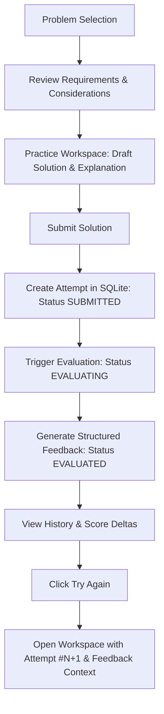
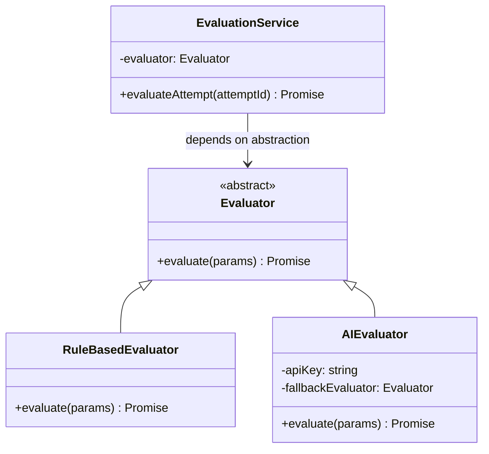

# LLD Arena — System Design Document

## 1. Problem Understanding

Low-Level Design (LLD) interviews and real-world system architecture require engineers to break complex business problems into clean, modular, and extensible object-oriented models. Unlike algorithmic coding challenges (where a binary pass/fail test runner suffices), software design solutions cannot be judged solely by standard I/O execution. 

Design challenges have multiple valid solutions and depend heavily on:
- Appropriate separation of concerns (Single Responsibility Principle)
- Loose coupling through abstractions and interfaces (Open-Closed Principle)
- Appropriate design pattern application (Strategy, State, Observer, Factory)
- Extensibility for evolving product requirements

**LLD Arena** addresses this gap by providing an interactive practice platform where developers design domain models, receive structured and explainable feedback across concrete architectural criteria, and iteratively refine their solutions over multiple attempts.

---

## 2. User Journey

The learner journey models an iterative engineering feedback loop:



---

## 3. Domain Model

The core domain model is encapsulated into clear domain entities:

### `Problem`
- **Location:** `server/domain/Problem.js`
- **Responsibilities:**
  - Encapsulates problem definition: title, descriptions, difficulty, and category.
  - Holds functional requirements checklist and architectural design considerations.
  - Manages starter code skeletons and explanation prompts.
  - Validates problem integrity.

### `Attempt`
- **Location:** `server/domain/Attempt.js`
- **Responsibilities:**
  - Represents a single learner submission for a specific problem.
  - Tracks iteration through `attemptNumber`.
  - Implements the lifecycle state machine:
    - `SUBMITTED`: Stored in SQLite before evaluation runs.
    - `EVALUATING`: Active grading in progress.
    - `EVALUATED`: Successfully evaluated with final score.
    - `FAILED`: Evaluation error occurred; submitted solution remains safely stored.
  - Enforces invariant validation (e.g., rejecting empty solution text).

### `Feedback`
- **Location:** `server/domain/Feedback.js`
- **Responsibilities:**
  - Represents the evaluation output linked 1-to-1 with an `Attempt`.
  - Holds the structured 6-category score breakdown.
  - Stores qualitative arrays: `strengths`, `areasToImprove`, `suggestedImprovements`, and `overallFeedback`.

### `Draft`
- **Location:** `server/repositories/DraftRepository.js`
- **Responsibilities:**
  - Persists unsubmitted, in-progress code and explanations in SQLite per problem.
  - Allows learners to navigate away from the workspace and resume later without data loss.

---

## 4. Backend Architecture

The backend follows a layered architecture with strict separation of concerns:

```
HTTP Clients (React Frontend / Tests)
               │
               ▼
   Controllers / Express Routes
               │
               ▼
      Application Services
       ├── ProblemService
       ├── AttemptService
       └── EvaluationService ───► Evaluator (Strategy Abstraction)
               │
               ▼
         Repositories
       ├── ProblemRepository
       ├── AttemptRepository
       ├── FeedbackRepository
       └── DraftRepository
               │
               ▼
     SQLite Database Engine (better-sqlite3)
```

1. **Controllers & Routes:** Handle HTTP concerns, URL parameter extraction, status codes (`200`, `201`, `400`, `404`, `500`), and JSON serialization.
2. **Services:** Coordinate business logic, enforce domain rules, manage lifecycle states, and execute evaluations.
3. **Repositories:** Encapsulate all SQL execution and mapping to domain models.
4. **SQLite Engine:** Persistent storage utilizing Write-Ahead Logging (WAL) and foreign keys.

---

## 5. Evaluator Architecture (Strategy Pattern & DIP)

Evaluation is decoupled through an explicit strategy abstraction:



### Why Dependency Inversion?
`EvaluationService` depends on the `Evaluator` abstraction, injected via constructor parameters:
```javascript
export class EvaluationService {
  constructor(evaluator, attemptRepository, feedbackRepository, problemRepository) {
    this.evaluator = evaluator;
    // ...
  }
}
```
This guarantees that:
- Adding a new evaluator (e.g., an AST-based parser or fine-tuned LLM) requires zero changes to `EvaluationService` or HTTP controllers.
- Unit and integration tests can inject mock or failing evaluators to verify error handling deterministically.

---

## 6. Key Low-Level Design Decisions

### 1. Persistence Before Evaluation
When a learner submits, `POST /api/attempts` saves the submission with status `SUBMITTED` *before* evaluation is triggered via `POST /api/attempts/:id/evaluate`. This eliminates data loss if a network timeout or evaluation crash occurs.

### 2. Attempt Immutability & Retry Isolation
Clicking "Try Again" (`POST /api/attempts/:id/retry`) creates a brand-new `Attempt` row with `attempt_number = MAX(attempt_number) + 1`. Past attempts are never overwritten or mutated, preserving the learner's complete historical progression and score deltas.

### 3. Deterministic Scoring Rubric
The `RuleBasedEvaluator` grades solutions out of 100 across 6 distinct categories:
- **Requirements Coverage (20 max):** Detection of required domain concepts.
- **Responsibility Separation (20 max):** Distribution of logic across classes, interfaces, and strategies.
- **Abstraction (20 max):** Proper usage of interfaces and abstract contracts.
- **Extensibility (15 max):** Utilization of pluggable design patterns (Strategy, State, Factory).
- **Object Relationships (15 max):** Composition and collections over rigid monolithic arrays.
- **Design Quality (10 max):** Encapsulation (`private` fields) and trade-off explanations.

The engine is deterministic: the same input produces the exact same score and feedback every time.

---

## 7. Failure Handling

If an unexpected exception occurs during evaluation:
1. `EvaluationService` catches the exception.
2. The attempt status in SQLite is updated to `FAILED`.
3. The submitted `solution` text and `explanation` remain intact in the database.
4. The service returns a clean HTTP error without exposing internal stack traces.
5. The learner can retry evaluation on the existing attempt without retyping their code.

---

## 8. Extensibility

The codebase is organized for clean extension:
- **Adding New Problems:** Insert problem definitions with requirement lists and starter templates into `server/data/seed.js`. No changes to controllers or evaluation logic required.
- **Adding New Evaluator Implementations:** Create a class extending `Evaluator` (e.g., `AstEvaluator` or `ClaudeEvaluator`) and inject it into `EvaluationService` inside `server/app.js`.
- **Alternative Storage Backends:** Implement the repository interfaces (`ProblemRepository`, `AttemptRepository`) for PostgreSQL or MySQL without altering domain entities or services.

---

## 9. Architectural Trade-offs

### Monolith vs. Distributed Microservices
- **Choice:** Monolithic Node.js/Express + React application.
- **Rationale:** For an MVP evaluation platform, a monolith eliminates distributed transaction complexity, network latency between services, RPC overhead, and deployment friction while demonstrating clean Low-Level Design.

### SQLite vs. External Database Server
- **Choice:** Embedded SQLite with Write-Ahead Logging (`better-sqlite3`).
- **Rationale:** Zero external infrastructure setup, instant cold-start time, transactional safety, and effortless local portability for evaluation and review.

---

## 10. Future Architectural Improvements

1. **AST-Based Syntax Validation:** Integrating tree-sitter or language-specific parsers to detect syntax errors before evaluating design semantics.
2. **Dynamic Class Diagram Rendering:** Generating real-time Mermaid.js or SVG class diagrams directly from the submitted code.
3. **Multi-Model AI Arbitration:** Combining rule-based structural checks with an LLM for conversational architectural mentoring.
